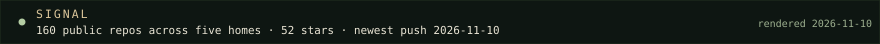

  

  

Nothing is definite, everything is interconnected. 

**Ahraz Arifuddin** · founder of [ASKA Digital](https://digital.askaconsult.com/) 

**observation > opinion**

**execution > credit.**

My work is a connected network of endeavours: from a personal agent to the languages agents use to the proofs beneath software to the hardware and infrastructure that support it. 

| Home | What lives there | Start here |
| --- | --- | --- |
| [Foundation-0](https://github.com/Foundation-0) | Open research in public. Negative results keep company with the wins. Frontier math, lattice chemistry, plates, proofs. | [f0](https://github.com/Foundation-0/f0), the frontier ledger · [incentre-lattices](https://github.com/Foundation-0/incentre-lattices), one drawing followed all the way down · [project-asma](https://github.com/Foundation-0/project-asma), in memory of Asma Ansari |
| [Moissanite Labs](https://github.com/Moissanite-Labs) | [Weft](https://w3ft.org/): models as cells, committed only within a measured distance of a saved baseline. Plus the [Siliconcordat](https://siliconcordat.com/) working proposal, [Eido](https://github.com/Moissanite-Labs/weft-eido) (style as a point in a continuous space), and [Abios](https://github.com/Moissanite-Labs/abios) (SYM-2P: a 101-byte packet where the JSON took 481). | [exo](https://github.com/Moissanite-Labs/exo), one agent with one continuous memory · [weft-eido](https://github.com/Moissanite-Labs/weft-eido) · [weft-corpus](https://github.com/Moissanite-Labs/weft-corpus), the discovery sessions, verbatim |
| [ASKA Digital](https://github.com/aska-digital) | The operating arm: client platforms, AI workflows, and a multi-agent engineering team where every build passes acceptance rubrics before it ships. | [protean-kit](https://github.com/aska-digital/protean-kit), the locked composer · [divan-bus](https://github.com/aska-digital/divan-bus), signed hash-chained agent relay · [dabba](https://github.com/aska-digital/dabba), home-cooked food, pooled orders, tipping-point pricing |
| [Proven Commons](https://github.com/Proven-Commons) | A bar for code anyone can check: lean-verified versions of the libraries the world runs on, built and reviewed in public. | [mission](https://proven-commons.github.io/mission/), the bar and how it holds · [tar](https://github.com/Proven-Commons/tar), proved no-escape extraction gate |

## Now

- [Siliconcordat](https://siliconcordat.com/) · Moissanite Labs' working proposal for how people and digital intelligences govern shared work. Published as a proposal, not adopted law.
- The [Weft papers](https://w3ft.org/papers/overview/) are at v1.1. Each claim ships with a test that could fail it.
- [digital.askaconsult.com/b.log](https://digital.askaconsult.com/blog/index.html) · field notes from the consultancy, written to be checked.
- [ahraz.askaconsult.com](https://ahraz.askaconsult.com/) · the personal site: [journey](https://ahraz.askaconsult.com/journey), [belief](https://ahraz.askaconsult.com/belief), [notes](https://ahraz.askaconsult.com/notes). The essay [Anomalies Are Not Noise](https://ahraz.askaconsult.com/notes/anomalies-are-not-noise) is the best single reading of where this is all headed.

## Why

Avicenna and Averroes treated philosophy and science as part of a religious life. I grew up on both, and I build as if both were true: curiosity is a duty, and a claim you cannot check is not yet a claim at all.

## The mark

The square, its diagonals, and four incentres. `R = √2 − 1` is the smaller radius it carves out of the larger one, which is how small work compounds into large structures. The header and the signal strip on this page are generated by the scripts in this repository. The hue ring is Eido's barycentric style mixing, with hue averaged on the circle, rendered daily by this repo's workflow.

## Elsewhere

[ahraz.askaconsult.com](https://ahraz.askaconsult.com/) · [digital.askaconsult.com](https://digital.askaconsult.com/) · [siliconcordat.com](https://siliconcordat.com/) · [w3ft.org](https://w3ft.org/) · [fdn0.org](https://fdn0.org/) · [mission](https://proven-commons.github.io/mission/) · [lab site](https://moissanite-labs.github.io/.github/) · [Nana's Golden Apothecary](https://ahrazzle.github.io/nanaveda/)
